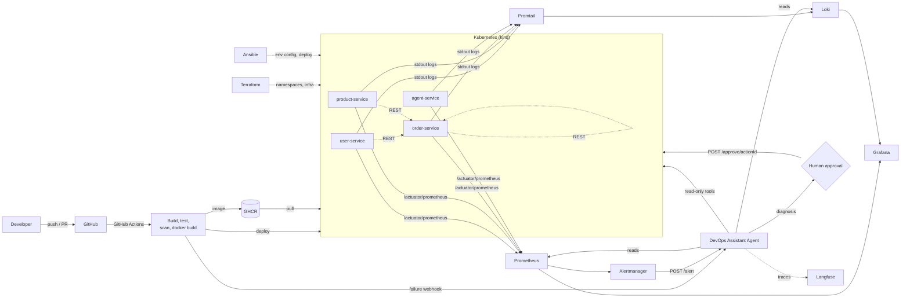

# Agentic AI-Driven DevSecOps Pipeline

End-to-end local DevSecOps platform for a Java (Spring Boot) microservices application, with an **agentic AI assistant** that investigates CI/CD failures, monitoring alerts, and security scan findings, then recommends a fix. Anything state-changing (rollback, restart, scale) requires **human approval**.

> University project. Runs fully on a laptop using free tools only. No paid cloud.

---

## Status

<!-- Badges are added in Phase 2 (CI), Phase 7 (security), later phases as they land. -->
[](https://github.com/Aarthi035/devsecops-agentic-platform/actions/workflows/ci.yml)

| Phase | Scope | Status |
|------:|-------|--------|
| 0 | Repo skeleton, README, prerequisites | done |
| 1 | Microservices app + Git workflow | done |
| 2 | CI pipeline (build matrix, tests, caching, artifacts) | done |
| 3 | Dockerfiles (multi-stage, non-root), docker-compose, GHCR push | done |
| 4 | Kubernetes manifests on kind + CD and rollback | pending |
| 5 | Terraform (namespaces/infra) + Ansible (env config) | pending |
| 6 | Monitoring and logging (Prometheus, Grafana, Loki, Promtail, Alertmanager) | pending |
| 7 | DevSecOps (Trivy, Dependency-Check/SonarQube, gitleaks, RBAC, NetworkPolicies) | pending |
| 8 | Agent v1 (CI log analysis, `/analyze-ci`, PR comment) | pending |
| 9 | Agent v2 (Prometheus/Loki/kubectl/Trivy tools, `/alert`, approval gate, audit log) | pending |
| 10 | Evals, Langfuse tracing, Grafana agent panel, demo scripts, report | pending |

---

## Problem

Manual build, deploy, and monitoring is slow and error-prone. When a pipeline fails, a vulnerability is flagged, or a service misbehaves in production, developers burn time reading long logs and switching between CI, monitoring, and security tools. Fixes are delayed, downtime grows, and vulnerabilities slip through.

## Solution

Code pushed to GitHub is built, tested, scanned, containerized, and deployed to Kubernetes. Infrastructure is defined as code. Metrics and logs are collected and visualized. An AI agent is triggered by failures/alerts, investigates with tools, and returns a structured diagnosis plus a recommended action — with human approval for anything risky.

---

## Architecture



Full diagram and component notes: `docs/architecture.md` (Phase 1+).

---

## Tech stack

| Layer | Tools |
|-------|-------|
| Application | Java 17, Spring Boot 3, Maven, Spring Data JPA, H2, JUnit 5, Actuator + Micrometer (Prometheus) |
| VCS / CI/CD | Git, GitHub, GitHub Actions |
| Containers | Docker (multi-stage), Docker Compose, Kubernetes on kind |
| IaC / config | Terraform, Ansible |
| Observability | Prometheus, Grafana, Loki, Promtail, Alertmanager |
| Security | Trivy, OWASP Dependency-Check (or SonarQube), gitleaks, GitHub Secrets, K8s RBAC, NetworkPolicies, non-root containers |
| Agent | Java 17 + Spring Boot (Spring AI / LangChain4j), Ollama local LLM, Langfuse tracing |

---

## Repository structure

```
devsecops-agentic-platform/
├── .github/
│   ├── PULL_REQUEST_TEMPLATE.md
│   └── workflows/            # ci.yml, cd.yml, security.yml (Phase 2+)
├── ansible/
│   ├── inventory/
│   └── playbooks/
├── docs/                     # prerequisites, architecture, report outline, demo scripts
├── evals/                    # failure scenarios, expected root causes, runner script (Phase 10)
├── k8s/
│   ├── base/                 # per-service Deployment/Service/ConfigMap/Secret/HPA/Ingress
│   ├── monitoring/
│   ├── network-policies/
│   └── rbac/
├── monitoring/
│   ├── alertmanager/
│   ├── grafana/dashboards/
│   ├── loki/
│   ├── prometheus/rules/
│   └── promtail/
├── services/
│   ├── agent-service/        # DevOps Assistant Agent (Phase 8+)
│   ├── order-service/        # calls user-service + product-service
│   ├── product-service/
│   └── user-service/
│                             # each service folder has Dockerfile + .dockerignore (Phase 3)
├── terraform/                # namespaces + infra (Phase 5)
├── .gitattributes
├── .gitignore
├── docker-compose.yml        # Phase 3
├── PROJECT_SPEC.md
└── README.md
```

---

## Getting started

1. Install the toolchain — see the [prerequisites checklist](docs/prerequisites.md).
2. Clone the repo. **Use a short, plain-ASCII path** — a path containing non-ASCII characters (e.g. `เอกสาร`) or a OneDrive-synced folder makes Maven fail with `Cannot create resource output directory`.
   ```bash
   # WSL2 (recommended for Phases 3-6)
   git clone https://github.com/Aarthi035/devsecops-agentic-platform.git ~/devsecops-agentic-platform

   # Windows (Phases 0-2 are fine here)
   git clone https://github.com/Aarthi035/devsecops-agentic-platform.git C:\Users\<you>\devsecops-agentic-platform

   cd devsecops-agentic-platform
   ```
3. Run the verification commands at the end of [docs/prerequisites.md](docs/prerequisites.md) — all must pass before Phase 1.

Per-phase run instructions are added to this README as each phase lands.

---

## Microservices (Phase 1)

Three Spring Boot 3.3.5 services on Java 17, each with its own H2 in-memory database, Actuator + Micrometer Prometheus metrics, and a JUnit 5 test suite.

| Service | Port | Database | Responsibility |
|---------|-----:|----------|----------------|
| user-service | 8081 | `userdb` | CRUD for users, seeds 5 demo users |
| product-service | 8082 | `productdb` | CRUD for products, seeds 6 demo products |
| order-service | 8083 | `orderdb` | Places orders by calling the other two over REST |

`order-service` is the consumer: `POST /api/orders` fetches the user, fetches the product, rejects inactive users and insufficient stock, then stores the order with a price snapshot.

### REST API

| Method | user-service | product-service | order-service |
|--------|--------------|-----------------|---------------|
| GET | `/api/users`, `/api/users/{id}`, `/api/users?email=` | `/api/products`, `/api/products/{id}`, `/api/products?category=` | `/api/orders`, `/api/orders/{id}`, `/api/orders?userId=` |
| POST | `/api/users` → 201 + `Location` | `/api/products` → 201 + `Location` | `/api/orders` → 201 + `Location`, `/api/orders/{id}/confirm`, `/api/orders/{id}/cancel` |
| PUT | `/api/users/{id}` | `/api/products/{id}` | — |
| DELETE | `/api/users/{id}` → 204 | `/api/products/{id}` → 204 | — |

- Error body is identical across services: `{timestamp, status, error, message, path}`.
- Status codes: `400` validation, `404` unknown id, `409` duplicate data / business rule (inactive user, insufficient stock), `502` downstream service unreachable.
- Actuator on every service: `/actuator/health` plus `/actuator/health/liveness` and `/actuator/health/readiness` (used by the Kubernetes probes in Phase 4), `/actuator/metrics`, `/actuator/prometheus`.

### Run locally

```bash
# one terminal per service, from the repository root
cd services/user-service    && mvn spring-boot:run
cd services/product-service && mvn spring-boot:run
cd services/order-service   && mvn spring-boot:run
```

`order-service` calls `http://localhost:8081` and `http://localhost:8082` by default; override with `USER_SERVICE_URL` / `PRODUCT_SERVICE_URL` (Kubernetes does this in Phase 4).

### Test

```bash
cd services/user-service    && mvn -B clean verify
cd services/product-service && mvn -B clean verify
cd services/order-service   && mvn -B clean verify
```

Each service has unit tests (Mockito) and API tests (MockMvc). Integration tests disable seeding with `APP_SEED_ENABLED=false` so they start from an empty database.

---

## Containers (Phase 3)

Each service has its own **multi-stage** `Dockerfile`:

| Stage | Base image | Purpose |
|-------|-----------|---------|
| `build` | `maven:3.9.9-eclipse-temurin-17` | `dependency:go-offline`, then `mvn clean package -Dmaven.test.skip=true` |
| `runtime` | `eclipse-temurin:17-jre-jammy` | JRE only — no Maven, no sources, no build tools |

The `build` stage is discarded, so none of the ~500 MB toolchain reaches the published image.

Container hardening:

- **Non-root.** `groupadd`/`useradd` create `app` with uid/gid `1001`; the image sets `USER 1001:1001`. CI fails the build if `Config.User` is empty or root.
- **glibc, not musl.** The runtime base is the Ubuntu `jammy` variant of Temurin; the `alpine` tag does not exec on the local Docker Desktop host.
- **Layer caching.** `pom.xml` is copied before `src/`, so the dependency layer is reused while only source code changes.
- **`HEALTHCHECK`** calls `/actuator/health/readiness`, which is what `docker compose` and the Phase 4 Kubernetes probes rely on.
- **`ENTRYPOINT ["/bin/sh","-c","exec java $JAVA_OPTS -jar /app/app.jar"]`** — the `exec` keeps `java` as PID 1, so `SIGTERM` reaches the JVM and the configured graceful shutdown works.
- **`.dockerignore`** keeps `target/` and `.git/` out of the build context.

### docker-compose

`docker-compose.yml` runs all three services on one bridge network:

```bash
docker compose up --build -d
docker compose ps          # wait for all three to report (healthy)
```

- `order-service` waits for the other two via `depends_on: condition: service_healthy`, which reads the images' `HEALTHCHECK`.
- Inside the network each service is reachable as `<service-name>:<port>`, so `order-service` gets `USER_SERVICE_URL=http://user-service:8081` and `PRODUCT_SERVICE_URL=http://product-service:8082` (not `localhost`).
- No `version:` key — it is obsolete in Compose v2.

### Publish to GHCR

The `docker` job in [`ci.yml`](.github/workflows/ci.yml) builds every image on push to `main`/`dev`/`v*` tags and pushes to GitHub Container Registry only from `main` and version tags:

```
ghcr.io/aarthi035/devsecops-agentic-platform/user-service:sha-<short-sha>
ghcr.io/aarthi035/devsecops-agentic-platform/user-service:latest
```

It authenticates with the built-in `GITHUB_TOKEN` (job-level `permissions: packages: write`), so no long-lived registry secret is stored. Phase 4 consumes these images in Kubernetes.

---

## CI pipeline (Phase 2, extended in Phase 3)

[`.github/workflows/ci.yml`](.github/workflows/ci.yml) runs on every push to `main`, `dev` and `feature/**`, on every PR into `main`/`dev`, and on demand.

| Job | What it does |
|-----|--------------|
| `build` (matrix: 3 services) | Checks out, sets up Temurin JDK 17, restores the Maven cache, runs `mvn -B verify`, writes a per-service test summary to the run's Summary tab, uploads surefire reports and the runnable jar as artifacts |
| `docker` (matrix: 3 services) | Phase 3 — builds each multi-stage image, asserts it does not run as root, pushes to GHCR from `main`/tags |
| `ci-status` | Single gate for branch protection — fails if **any** matrix leg failed |

Design notes:

- **Matrix, `fail-fast: false`** — the three services are independent Maven projects, so they build in parallel and one failure never hides another.
- **Caching** — `actions/setup-java` caches `~/.m2/repository` keyed on each service's `pom.xml`, so a dependency change invalidates the cache and a code-only change reuses it.
- **Artifacts** — `test-reports-<service>` (7 days) and `<service>-jar` (7 days).
- **Least privilege** — the workflow declares `permissions: contents: read`; only the `docker` job widens that, and only with `packages: write`.
- **Concurrency** — pushing twice to the same branch cancels the in-flight run instead of queueing.
- **No third-party actions** beyond `actions/checkout`, `actions/setup-java` and `actions/upload-artifact`, which keeps the supply-chain surface small before Phase 7 starts scanning it. The image build uses plain `docker build`/`docker push` rather than an extra action.
- **`docker` is skipped on pull requests** and only pushes from `main`/`v*` tags, so feature branches still prove the Dockerfile builds without publishing a moving `latest` tag.

The badge at the top of this README reflects the `main` branch run.

---

## Git workflow

| Branch | Purpose |
|--------|---------|
| `main` | Always deployable. Protected: PR required, CI must pass. |
| `dev` | Integration branch. Feature branches merge here first. |
| `feature/<short-name>` | One unit of work, branched from `dev`. |
| `fix/<short-name>` | Bug fixes. |
| `chore/<short-name>` | Config, CI, docs, repo maintenance. |

Commit messages follow Conventional Commits: `feat:`, `fix:`, `ci:`, `infra:`, `docs:`, `test:`, `chore:`.

Typical flow:

```bash
git switch dev && git pull
git switch -c feature/user-service-crud
# ... work ...
git add -A && git commit -m "feat(user-service): add CRUD REST API"
git push -u origin feature/user-service-crud
# open PR -> dev, fill in PULL_REQUEST_TEMPLATE.md
```

Every PR must state how it was verified and confirm no secrets were committed.

---

## Course outcome mapping

| CO | Outcome | Where it is satisfied |
|----|---------|-----------------------|
| CO1 | DevOps principles (Git workflow, automation, feedback loops) | Phases 1-2: branch strategy, PR template, CI feedback, badges |
| CO2 | CI/CD pipelines | Phases 2, 4: `ci.yml`, `cd.yml`, artifacts, rollback |
| CO3 | Containerization and orchestration | Phases 3-4: multi-stage Dockerfiles, Compose, kind, HPA, Ingress |
| CO4 | Automated infra and config management | Phase 5: Terraform namespaces/infra, Ansible playbooks |
| CO5 | Monitoring and logging | Phase 6: Prometheus, Grafana, Loki, Promtail, Alertmanager |
| CO6 | Security in DevOps | Phase 7: Trivy, Dependency-Check, gitleaks, secrets, RBAC, NetworkPolicies |

---

## Demo scenarios

1. **Broken unit test** — agent explains the failure and suggests the fix.
2. **Vulnerable dependency** — pipeline fails, agent summarizes Trivy findings with upgrade advice.
3. **Pod crash / CPU spike** — Alertmanager triggers the agent; it reads metrics + logs and recommends restart or scale-up.
4. **Rollback** — agent proposes a rollback, human approves, rollback executes.

---

## Agent guardrails

- Read-only by default; every state-changing action needs `POST /approve/{actionId}`.
- Max steps per run and max token budget per run.
- Dedicated Kubernetes ServiceAccount with least-privilege RBAC.
- Append-only audit log of every tool call and decision.
- Secrets only from environment variables / Kubernetes Secrets — never in code or prompts.
- Logs truncated and sanitized before being sent to the LLM.

---

## Documentation

| Document | Contents |
|----------|----------|
| [PROJECT_SPEC.md](PROJECT_SPEC.md) | Full project specification, phases, evaluation plan |
| [docs/prerequisites.md](docs/prerequisites.md) | Tools, versions, install and verification commands |
| `docs/architecture.md` | Mermaid architecture diagram (Phase 1+) |
| `docs/report-outline.md` | Report structure (Phase 10) |
| `docs/demo-scripts.md` | Step-by-step demo runbook (Phase 10) |
