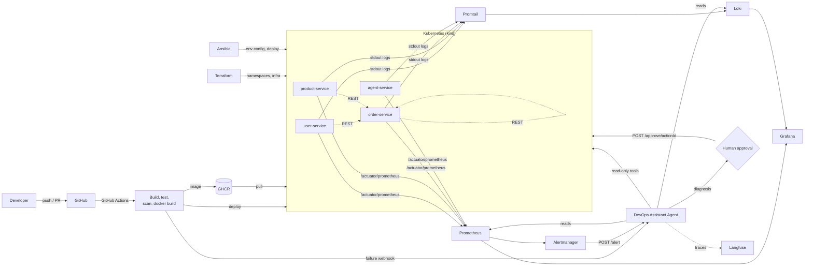

# Agentic AI-Driven DevSecOps Pipeline

End-to-end local DevSecOps platform for a Java (Spring Boot) microservices application, with an **agentic AI assistant** that investigates CI/CD failures, monitoring alerts, and security scan findings, then recommends a fix. Anything state-changing (rollback, restart, scale) requires **human approval**.

> University project. Runs fully on a laptop using free tools only. No paid cloud.

---

## Status

<!-- Badges are added in Phase 2 (CI), Phase 7 (security), later phases as they land. -->
[](https://github.com/Aarthi035/devsecops-agentic-platform/actions/workflows/ci.yml)
[](https://github.com/Aarthi035/devsecops-agentic-platform/actions/workflows/cd.yml)

| Phase | Scope | Status |
|------:|-------|--------|
| 0 | Repo skeleton, README, prerequisites | done |
| 1 | Microservices app + Git workflow | done |
| 2 | CI pipeline (build matrix, tests, caching, artifacts) | done |
| 3 | Dockerfiles (multi-stage, non-root), docker-compose, GHCR push | done |
| 4 | Kubernetes manifests on kind + CD and rollback | done |
| 5 | Terraform (namespaces/infra) + Ansible (env config) | done |
| 6 | Monitoring and logging (Prometheus, Grafana, Loki, Promtail, Alertmanager) | done |
| 7 | DevSecOps (Trivy, Dependency-Check/SonarQube, gitleaks, RBAC, NetworkPolicies) | pending |
| 8 | Agent v1 (CI log analysis, `/analyze-ci`, PR comment) | pending |
| 9 | Agent v2 (Prometheus/Loki/kubectl/Trivy tools, `/alert`, approval gate, audit log) | pending |
| 10 | Evals, Langfuse tracing, Grafana agent panel, demo scripts, report | pending |

---

## Problem

Manual build, deploy, and monitoring is slow and error-prone. When a pipeline fails, a vulnerability is flagged, or a service misbehaves in production, developers burn time reading long logs and switching between CI, monitoring, and security tools. Fixes are delayed, downtime grows, and vulnerabilities slip through.

## Solution

Code pushed to GitHub is built, tested, scanned, containerized, and deployed to Kubernetes. Infrastructure is defined as code. Metrics and logs are collected and visualized. An AI agent is triggered by failures/alerts, investigates with tools, and returns a structured diagnosis plus a recommended action — with human approval for anything risky.

---

## Architecture



Full diagram and component notes: `docs/architecture.md` (Phase 1+).

---

## Tech stack

| Layer | Tools |
|-------|-------|
| Application | Java 17, Spring Boot 3, Maven, Spring Data JPA, H2, JUnit 5, Actuator + Micrometer (Prometheus) |
| VCS / CI/CD | Git, GitHub, GitHub Actions |
| Containers | Docker (multi-stage), Docker Compose, Kubernetes on kind |
| IaC / config | Terraform, Ansible |
| Observability | Prometheus, Grafana, Loki, Promtail, Alertmanager |
| Security | Trivy, OWASP Dependency-Check (or SonarQube), gitleaks, GitHub Secrets, K8s RBAC, NetworkPolicies, non-root containers |
| Agent | Java 17 + Spring Boot (Spring AI / LangChain4j), Ollama local LLM, Langfuse tracing |

---

## Repository structure

```
devsecops-agentic-platform/
├── .github/
│   ├── scripts/
│   │   └── check-monitoring.py      # Phase 6 - lints monitoring/*.yaml without a cluster
│   ├── PULL_REQUEST_TEMPLATE.md
│   └── workflows/            # ci.yml, cd.yml, security.yml (Phase 2+)
├── ansible/                  # Phase 5 - environment config + deployment
│   ├── inventory/
│   │   ├── group_vars/cluster.yml   # namespace, app_config, Secret values, rollout budget
│   │   └── hosts.ini                # one implicit localhost on the kind network
│   ├── playbooks/
│   │   ├── roles/environment/       # renders ConfigMap + Secret from the inventory
│   │   ├── roles/deploy/            # applies k8s/*.yaml, waits for the rollout
│   │   ├── roles/monitoring/        # Phase 6 - applies monitoring/*.yaml
│   │   ├── site.yml
│   │   └── verify.yml               # end-to-end check through the Ingress
│   ├── Dockerfile                   # Debian-based control node on the kind Docker network
│   ├── ansible.cfg
│   ├── requirements.txt             # kubernetes, jsonpatch, ansible-lint
│   └── requirements.yml             # kubernetes.core collection
├── docs/                     # prerequisites, architecture, report outline, demo scripts
├── evals/                    # failure scenarios, expected root causes, runner script (Phase 10)
├── k8s/                      # Phase 4 - applied in filename order
│   ├── 00-namespace.yaml
│   ├── 10-configmap.yaml
│   ├── 11-secret.yaml
│   ├── 20-user-service.yaml  # Deployment + ClusterIP Service
│   ├── 21-product-service.yaml
│   ├── 22-order-service.yaml
│   ├── 30-hpa.yaml
│   └── 40-ingress.yaml
├── kind/
│   └── kind-config.yaml      # cluster definition: port 80 -> host 8090
├── monitoring/               # Phase 6 - applied with "kubectl apply -R -f monitoring/"
│   ├── alertmanager/         # configmap.yaml (route/receivers), deployment.yaml (+ Service)
│   ├── grafana/              # datasources.yaml, dashboards.yaml (provider), deployment.yaml (uid 472)
│   │   └── dashboards/platform-overview.yaml   # the dashboard JSON, as a ConfigMap
│   ├── loki/                 # configmap.yaml (tsdb v13, 24h retention), deployment.yaml (+ Service)
│   ├── prometheus/           # configmap.yaml (scrape config), deployment.yaml (+ Service)
│   │   └── rules/platform-alerts.yaml          # the alert rules, as a ConfigMap
│   ├── promtail/             # configmap.yaml (pipeline), daemonset.yaml, rbac.yaml
│   └── ingress.yaml          # /prometheus, /grafana, /alertmanager through the same controller
├── services/
│   ├── agent-service/        # DevOps Assistant Agent (Phase 8+)
│   ├── order-service/        # calls user-service + product-service
│   ├── product-service/
│   └── user-service/
│                             # each service folder has Dockerfile + .dockerignore (Phase 3)
├── terraform/                # Phase 5 - namespaces, quota, add-ons
│   ├── namespace.tf          # Namespace + ResourceQuota + LimitRange
│   ├── addons.tf             # ingress-nginx + metrics-server Helm releases
│   ├── variables.tf          # kubeconfig path, namespace, chart pins, quota
│   ├── versions.tf           # provider + Terraform version constraints
│   ├── outputs.tf
│   └── terraform.tfvars.example
├── .gitattributes
├── .gitignore
├── docker-compose.yml        # Phase 3
├── PROJECT_SPEC.md
└── README.md
```

---

## Getting started

1. Install the toolchain — see the [prerequisites checklist](docs/prerequisites.md).
2. Clone the repo. **Use a short, plain-ASCII path** — a path containing non-ASCII characters (e.g. `เอกสาร`) or a OneDrive-synced folder makes Maven fail with `Cannot create resource output directory`.
   ```bash
   # WSL2 (recommended for Phases 3-6)
   git clone https://github.com/Aarthi035/devsecops-agentic-platform.git ~/devsecops-agentic-platform

   # Windows (Phases 0-2 are fine here)
   git clone https://github.com/Aarthi035/devsecops-agentic-platform.git C:\Users\<you>\devsecops-agentic-platform

   cd devsecops-agentic-platform
   ```
3. Run the verification commands at the end of [docs/prerequisites.md](docs/prerequisites.md) — all must pass before Phase 1.

Per-phase run instructions are added to this README as each phase lands.

---

## Microservices (Phase 1)

Three Spring Boot 3.3.5 services on Java 17, each with its own H2 in-memory database, Actuator + Micrometer Prometheus metrics, and a JUnit 5 test suite.

| Service | Port | Database | Responsibility |
|---------|-----:|----------|----------------|
| user-service | 8081 | `userdb` | CRUD for users, seeds 5 demo users |
| product-service | 8082 | `productdb` | CRUD for products, seeds 6 demo products |
| order-service | 8083 | `orderdb` | Places orders by calling the other two over REST |

`order-service` is the consumer: `POST /api/orders` fetches the user, fetches the product, rejects inactive users and insufficient stock, then stores the order with a price snapshot.

### REST API

| Method | user-service | product-service | order-service |
|--------|--------------|-----------------|---------------|
| GET | `/api/users`, `/api/users/{id}`, `/api/users?email=` | `/api/products`, `/api/products/{id}`, `/api/products?category=` | `/api/orders`, `/api/orders/{id}`, `/api/orders?userId=` |
| POST | `/api/users` → 201 + `Location` | `/api/products` → 201 + `Location` | `/api/orders` → 201 + `Location`, `/api/orders/{id}/confirm`, `/api/orders/{id}/cancel` |
| PUT | `/api/users/{id}` | `/api/products/{id}` | — |
| DELETE | `/api/users/{id}` → 204 | `/api/products/{id}` → 204 | — |

- Error body is identical across services: `{timestamp, status, error, message, path}`.
- Status codes: `400` validation, `404` unknown id, `409` duplicate data / business rule (inactive user, insufficient stock), `502` downstream service unreachable.
- Actuator on every service: `/actuator/health` plus `/actuator/health/liveness` and `/actuator/health/readiness` (used by the Kubernetes probes in Phase 4), `/actuator/metrics`, `/actuator/prometheus`.

### Run locally

```bash
# one terminal per service, from the repository root
cd services/user-service    && mvn spring-boot:run
cd services/product-service && mvn spring-boot:run
cd services/order-service   && mvn spring-boot:run
```

`order-service` calls `http://localhost:8081` and `http://localhost:8082` by default; override with `USER_SERVICE_URL` / `PRODUCT_SERVICE_URL` (Kubernetes does this in Phase 4).

### Test

```bash
cd services/user-service    && mvn -B clean verify
cd services/product-service && mvn -B clean verify
cd services/order-service   && mvn -B clean verify
```

Each service has unit tests (Mockito) and API tests (MockMvc). Integration tests disable seeding with `APP_SEED_ENABLED=false` so they start from an empty database.

---

## Containers (Phase 3)

Each service has its own **multi-stage** `Dockerfile`:

| Stage | Base image | Purpose |
|-------|-----------|---------|
| `build` | `maven:3.9.9-eclipse-temurin-17` | `dependency:go-offline`, then `mvn clean package -Dmaven.test.skip=true` |
| `runtime` | `eclipse-temurin:17-jre-jammy` | JRE only — no Maven, no sources, no build tools |

The `build` stage is discarded, so none of the ~500 MB toolchain reaches the published image.

Container hardening:

- **Non-root.** `groupadd`/`useradd` create `app` with uid/gid `1001`; the image sets `USER 1001:1001`. CI fails the build if `Config.User` is empty or root.
- **glibc, not musl.** The runtime base is the Ubuntu `jammy` variant of Temurin; the `alpine` tag does not exec on the local Docker Desktop host.
- **Layer caching.** `pom.xml` is copied before `src/`, so the dependency layer is reused while only source code changes.
- **`HEALTHCHECK`** calls `/actuator/health/readiness`, which is what `docker compose` and the Phase 4 Kubernetes probes rely on.
- **`ENTRYPOINT ["/bin/sh","-c","exec java $JAVA_OPTS -jar /app/app.jar"]`** — the `exec` keeps `java` as PID 1, so `SIGTERM` reaches the JVM and the configured graceful shutdown works.
- **`.dockerignore`** keeps `target/` and `.git/` out of the build context.

### docker-compose

`docker-compose.yml` runs all three services on one bridge network:

```bash
docker compose up --build -d
docker compose ps          # wait for all three to report (healthy)
```

- `order-service` waits for the other two via `depends_on: condition: service_healthy`, which reads the images' `HEALTHCHECK`.
- Inside the network each service is reachable as `<service-name>:<port>`, so `order-service` gets `USER_SERVICE_URL=http://user-service:8081` and `PRODUCT_SERVICE_URL=http://product-service:8082` (not `localhost`).
- No `version:` key — it is obsolete in Compose v2.

### Publish to GHCR

The `docker` job in [`ci.yml`](.github/workflows/ci.yml) builds every image on push to `main`/`dev`/`v*` tags and pushes to GitHub Container Registry only from `main` and version tags:

```
ghcr.io/aarthi035/devsecops-agentic-platform/user-service:sha-<short-sha>
ghcr.io/aarthi035/devsecops-agentic-platform/user-service:latest
```

It authenticates with the built-in `GITHUB_TOKEN` (job-level `permissions: packages: write`), so no long-lived registry secret is stored. Phase 4 consumes these images in Kubernetes.

---

## Kubernetes (Phase 4)

The three services run on a local **kind** cluster. `kind/kind-config.yaml` defines it:

- a single control-plane node labelled `ingress-ready=true` — the label the ingress-nginx kind manifest selects on
- node image pinned to `kindest/node:v1.33.12`
- node port `80` published on host port **8090** (and `443` on `8443`), which is what makes the Ingress reachable from the laptop

Kubernetes 1.33 is pinned deliberately: kind's default node image (v1.37) never brings the control plane up on a host running cgroup v1, which is the case for this Docker Desktop install.

| Manifest | Object | Purpose |
|----------|--------|---------|
| `k8s/00-namespace.yaml` | `Namespace/devsecops` | isolates the app |
| `k8s/10-configmap.yaml` | `ConfigMap/app-config` | `APP_SEED_ENABLED`, `USER_SERVICE_URL`, `PRODUCT_SERVICE_URL` |
| `k8s/11-secret.yaml` | `Secret/app-credentials` | secret **shape** only — values are injected at deploy time so no credential is ever committed |
| `k8s/20..22-*.yaml` | `Deployment` + `ClusterIP Service` | one per service, with probes and resource limits |
| `k8s/30-hpa.yaml` | `HorizontalPodAutoscaler` ×3 | `autoscaling/v2`, 1→3 replicas, target 70% CPU |
| `k8s/40-ingress.yaml` | `Ingress/devsecops-api` | routes `/api/users`, `/api/products`, `/api/orders` to the right Service |

Pod hardening — every pod runs with:

- `runAsNonRoot: true`, `runAsUser/runAsGroup/fsGroup: 1001` (matches the Dockerfile's `app` user)
- `seccompProfile: RuntimeDefault`, `allowPrivilegeEscalation: false`
- `readOnlyRootFilesystem: true` with an `emptyDir` mounted at `/tmp` for the JVM's temp files
- `capabilities.drop: ["ALL"]`

Three probes per container: a `startupProbe` on `/actuator/health/readiness` (5 s period, 30 failures — up to ~150 s for the JVM to boot) gates a `readinessProbe` on the same path and a `livenessProbe` on `/actuator/health/liveness`. Requests are `100m`/`320Mi`, limits `500m`/`640Mi` per pod. The rollout strategy is `maxUnavailable: 0` / `maxSurge: 1`, so a bad image can never take the service down.

### Create the cluster

```bash
kind create cluster --config kind/kind-config.yaml
kubectl get nodes
```

### Install the two add-ons

Neither is part of kind; both must be installed before the manifests behave:

```bash
# Ingress controller. The "kind" provider manifest pins the controller to a node
# with the label set in kind-config.yaml and binds host ports 80/443.
kubectl apply -f https://raw.githubusercontent.com/kubernetes/ingress-nginx/controller-v1.11.3/deploy/static/provider/kind/deploy.yaml
kubectl wait --namespace ingress-nginx --for=condition=ready pod \
  --selector=app.kubernetes.io/component=controller --timeout=240s

# metrics-server, which is what feeds the HPA.
kubectl apply -f https://github.com/kubernetes-sigs/metrics-server/releases/latest/download/components.yaml
kubectl patch deployment metrics-server -n kube-system --type=json \
  -p '[{"op":"add","path":"/spec/template/spec/containers/0/args/-","value":"--kubelet-insecure-tls"}]'
kubectl wait --namespace kube-system --for=condition=available deployment/metrics-server --timeout=240s
```

The `--kubelet-insecure-tls` patch is mandatory on kind: metrics-server otherwise rejects the kubelet's self-signed certificate and the HPAs stay at `cpu: <unknown>` forever.

### Deploy

Local development loads the images straight from the Docker daemon into the node, so no registry round-trip is needed:

```bash
kind load docker-image --name devsecops \
  devsecops/user-service:1.0.0 devsecops/product-service:1.0.0 devsecops/order-service:1.0.0

kubectl apply -f k8s/
kubectl wait --for=condition=available deployment --all -n devsecops --timeout=300s
kubectl get pods,svc,ingress,hpa -n devsecops
```

### Verify

```bash
# every pod Ready, and non-root
kubectl get pods -n devsecops
kubectl exec -n devsecops deploy/user-service -- id        # uid=1001(app) gid=1001(app)

# Ingress routing from the host (port 8090 -> node port 80)
curl http://localhost:8090/api/users
curl http://localhost:8090/api/products

# end-to-end: order-service calls the other two over REST inside the cluster
curl -X POST http://localhost:8090/api/orders \
  -H 'Content-Type: application/json' \
  -d '{"userId":1,"productId":1,"quantity":3}'
curl -X POST http://localhost:8090/api/orders/1/confirm

# HPA has real numbers, not "<unknown>"
kubectl top pods -n devsecops
kubectl get hpa -n devsecops
```

### Rollback

`maxUnavailable: 0` means a failing rollout leaves the previous pods serving. To prove it, push a bad tag:

```bash
kubectl set image deployment/user-service user-service=devsecops/user-service:9.9.9 -n devsecops
kubectl get pods -n devsecops -l app.kubernetes.io/name=user-service   # new pod ErrImagePull
curl -o /dev/null -s -w '%{http_code}\n' http://localhost:8090/api/users   # still 200

kubectl rollout undo deployment/user-service -n devsecops
kubectl rollout status deployment/user-service -n devsecops --timeout=120s
```

`revisionHistoryLimit: 5` keeps the last five ReplicaSets, so `kubectl rollout history` / `rollout undo` work for the last few deploys.

### What has actually been tested

Verified on this laptop (Docker Engine 28.0.4, kind v0.33.0, kubectl v1.32.2, node `kindest/node:v1.33.12`):

| Check | Result |
|-------|--------|
| Cluster and add-ons | 1 node `Ready`; ingress-nginx controller and metrics-server `Available` |
| Deployments | all three `1/1` Ready, `devsecops/<service>:1.0.0` |
| Non-root | `kubectl exec deploy/user-service -- id` → `uid=1001(app) gid=1001(app)` |
| Ingress routing | `curl http://localhost:8090/api/users` and `/api/products` return the seeded data |
| Inter-service REST | `POST /api/orders` returns **201** with `"status":"CREATED"` and the price snapshot, so order-service reached both other Services by DNS name; `POST /api/orders/1/confirm` → `CONFIRMED` |
| Probes | pods stay `1/1` Ready. `kubectl get events --field-selector reason=Unhealthy` shows transient startup-probe `connection refused` while the JVM boots — that is the startup probe doing its job — and **zero** liveness-probe failures. The single `RESTARTS 1` each pod shows is the Docker Desktop restart, not a probe kill. |
| HPA | `kubectl top pods` and `kubectl get hpa` report real CPU (no `cpu: <unknown>`) |
| Rolling update | `kubectl set image` to an immutable `sha-<commit>` tag rolls out and becomes Ready |
| Rollback | `kubectl rollout undo` returns the Deployment to the previous revision and the API keeps answering |

Verified on GitHub Actions: the CI build/docker matrices, the combined `CI status` job, and the **whole CD deploy** — run
[39993077886](https://github.com/Aarthi035/devsecops-agentic-platform/actions/runs/39993077886) for commit `af3d0a9`
created the kind cluster, brought both add-ons to `condition met`, pulled the images by `sha-af3d0a9` from GHCR, applied
`k8s/`, pinned all three Deployments to `devsecops/<service>:sha-af3d0a9`, waited out the rollout and passed the Ingress
smoke test (all three endpoints `ok (attempt 1)`, `POST /api/orders` → `"status":"CREATED"`). The CD runs triggered by that
commit's `dev` CI run were reported **skipped**, not failed, which is the branch filter working as intended.

Not verified, and not claimed: a remote (cloud) cluster — the project runs locally by design and no remote kubeconfig
exists, so `cd.yml` targets a throwaway kind cluster on the runner only; and NetworkPolicies/RBAC, which arrive in Phase 7.

### CD

[`.github/workflows/cd.yml`](.github/workflows/cd.yml) triggers when a **CI** run completes, and deploys only when that run succeeded **on `main`** — the only place `ci.yml` publishes images. A manual `workflow_dispatch` always runs, so a deploy can be repeated on demand. `dev`, `feature/**` and pull-request runs are skipped rather than failed: they never publish the tags this workflow deploys.

A run then:

1. checks out the exact commit CI validated (`github.event.workflow_run.head_sha`, not the branch tip),
2. installs kind on the runner and creates a cluster from the same `kind/kind-config.yaml`,
3. installs both add-ons with the same commands used on the laptop,
4. pulls the images **by immutable tag** from GHCR — `sha-<commit>` — and loads them into the node,
5. applies `k8s/`, then pins each Deployment to that tag with `kubectl set image`, so the live revision names the commit it runs,
6. waits for the rollout and prints the image each Deployment ended up on,
7. smoke-tests `/api/users`, `/api/products` and `POST /api/orders` through the Ingress on port 8090. Every call is retried (12 attempts, 5 s apart), because the Ingress can answer `502` for a moment right after a rollout, and a single late call must not roll back a healthy deploy.

Any failure runs the **rollback** step: `kubectl rollout undo` for every Deployment, then a diagnostics dump (`kubectl describe pods`). Note that the very first deploy of a fresh cluster has only one revision, so there `rollout undo` is a no-op and the diagnostics are what tell you what went wrong.

The workflow needs no secrets beyond the built-in `GITHUB_TOKEN` (`contents: read`, `packages: read`): no kubeconfig and no cluster credential is stored in the repository or printed in the logs.

### Troubleshooting

| Symptom | Cause and fix |
|---------|---------------|
| `kind create cluster` fails in `wait-control-plane`, kubeadm logs `could not find officially supported version of etcd` | Host runs cgroup v1 and the node image is too new. Pin `kindest/node:v1.33.12` in `kind-config.yaml` as this repo does. |
| `failed to lock config file: .../.kube/config.lock: Access is denied` | The sandbox refuses writes to `~/.kube`. Create the cluster anyway, then `kind export kubeconfig --name devsecops --kubeconfig <path>` and point `KUBECONFIG` at that path. |
| Pods stuck `ImagePullBackOff` on `registry.k8s.io/...` with `TLS handshake timeout` | The node can't reach the CDN. Pull on the host instead (`docker pull <image>`) and `kind load docker-image` it in. |
| HPA shows `cpu: <unknown>/70%` | metrics-server missing or missing the `--kubelet-insecure-tls` patch. Confirm with `kubectl top pods -n devsecops`. |
| `kubectl get ingress` has no `ADDRESS` | ingress-nginx is not ready, or the controller pod is not on a node labelled `ingress-ready=true`. |
| CD fails seconds after `kubectl apply` of ingress-nginx with `error: no matching resources found` | `kubectl wait --for=... pod --selector=...` fails immediately when no Pod matches yet, and the controller's Pods do not exist for the first seconds after the apply. Wait on the Deployment's `Available` condition instead — which is what `cd.yml` now does. |
| Right after a rollout the Ingress answers `502` for a second or two | The Service endpoint is still propagating. Retry rather than treat it as failure: `cd.yml` retries every smoke-test call, so a healthy deploy is not rolled back on one transient `502`. |
| CD fails at `Install kind` | `curl -o ./kind` collides with the repository's `kind/` directory. Download to `/tmp/kind` instead — which is what `cd.yml` does. |

---

## Terraform and Ansible (Phase 5)

Phase 4 got the platform running with `kubectl apply` and two `kubectl`-installed add-ons. Phase 5 makes that state **declared** instead of typed: Terraform owns the infrastructure, Ansible owns the environment and the workloads.

| Tool | Owns | Lives in |
|------|------|----------|
| Terraform | `Namespace/devsecops`, the `ResourceQuota`/`LimitRange` around it, and the two cluster add-ons (as Helm releases) | [`terraform/`](terraform) |
| Ansible | The namespace's **contents**: the `ConfigMap`/`Secret` the services read, and the workloads from `k8s/` | [`ansible/`](ansible) |

The split is deliberate: `k8s/00-namespace.yaml` still exists for the plain `kubectl apply -f k8s/` path `cd.yml` uses, but **Terraform is the owner** of that object on the laptop. The two tools never create the same thing.

### Terraform

```bash
cd terraform
terraform init
terraform fmt -check -recursive   # style gate (also run in CI)
terraform validate
terraform plan                    # expected: "No changes" once applied
terraform apply
```

| File | Contents |
|------|----------|
| [`namespace.tf`](terraform/namespace.tf) | `Namespace/devsecops` (labelled `managed-by=terraform`), `ResourceQuota/platform-quota`, `LimitRange/platform-limits` |
| [`addons.tf`](terraform/addons.tf) | `helm_release.ingress_nginx` (namespace `ingress-nginx`) and `helm_release.metrics_server` (namespace `kube-system`) |
| [`variables.tf`](terraform/variables.tf) | `kubeconfig_path`, `kube_context`, `namespace`, the two chart pins, the quota and LimitRange numbers |
| [`versions.tf`](terraform/versions.tf) | Terraform ≥ 1.6, `hashicorp/kubernetes` 2.38.0, `hashicorp/helm` 2.17.0 |
| [`outputs.tf`](terraform/outputs.tf) | namespace/quota/limitrange names, installed chart versions, and the add-on facts the Phase 4 manifests depend on |

**Chart pins match what `cd.yml` installs**, so the laptop and CI run the same add-ons:

| Add-on | Chart | Controller / image |
|--------|-------|--------------------|
| ingress-nginx | `4.11.3` | controller **v1.11.3** (the same tag `cd.yml`'s kind provider manifest pins) |
| metrics-server | `3.14.0` | **v0.9.0** (what `releases/latest` currently resolves to) |

The chart version is not the controller version: chart 4.11.3 is the release whose `controller.image.tag` is `v1.11.3`. Each pin was verified against that chart's `values.yaml` at its own `helm-chart-*` tag.

Two kind-specific settings are declared in `addons.tf` rather than patched in by hand:

- **`--kubelet-insecure-tls`** on metrics-server — without it the kubelets' self-signed certificates are rejected and every HPA reports `cpu: <unknown>` forever (the Phase 4 lesson).
- **`updateStrategy = Recreate`** on the ingress-nginx controller. The controller publishes the node's host ports 80/443, so only one Pod can ever run on the single kind node; the chart's default `RollingUpdate` surges a second Pod that stays `Pending` with `didn't have free ports for the requested pod ports`, which also wedges every later `helm upgrade`/`terraform apply`. `Recreate` stops the old Pod first.

#### Adopting the existing cluster

The cluster already existed, so Terraform **imported** the objects instead of recreating them — no downtime, and the running workloads were left alone:

```bash
terraform import kubernetes_namespace_v1.platform devsecops
```

The add-ons were the one exception: Phase 4's `kubectl`-installed controller and metrics-server were removed and re-installed as Helm releases at the pinned chart versions, so Terraform (not a stray manifest) owns them from here on. No unrelated container, image, volume or database was touched.

#### The `KUBE_CONFIG_PATH` gotcha

Terraform's `kubernetes`/`helm` providers read the kubeconfig from `var.kubeconfig_path`, then **`KUBE_CONFIG_PATH`**, then `~/.kube/config`. They do **not** read `KUBECONFIG`. On a machine that only sets `KUBECONFIG` (kubectl works, Terraform does not), either set the variable the provider reads or pass the path explicitly:

```powershell
$env:KUBE_CONFIG_PATH = $env:KUBECONFIG      # or the exported admin.conf path
terraform apply -var="kubeconfig_path=$env:KUBECONFIG"
```

State is local and `.gitignore`d (`terraform.tfstate*`, `.terraform/`, `*.tfvars`), so no cluster state or personal kubeconfig path is ever committed. Later phases can move it to a remote backend without touching the resources.

### Ansible

Ansible has no control node on Windows, and kind binds the API server to the host's **loopback** interface only (`6443/tcp -> 127.0.0.1:52084`) — a control node in WSL reaches the host through the WSL gateway IP, which is not `127.0.0.1`, so the API is unreachable from there. [`ansible/Dockerfile`](ansible/Dockerfile) sidesteps that: a **Debian-based** control node **joined to the `kind` Docker network**, using the node's own `admin.conf` (`server: https://devsecops-control-plane:6443`). Inside that network the node answers to its own name, so both the URL and the certificate in `admin.conf` resolve.

```bash
# Build once.
docker build -t devsecops/ansible:latest ansible

# Configure the environment and deploy the workloads.
docker run --rm --network kind \
  -v "C:/Users/<you>/devsecops-agentic-platform:/workspace" \
  -v "C:/Users/<you>/AppData/Local/Temp/ds-iac/admin.conf:/root/.kube/config:ro" \
  --workdir /workspace/ansible \
  devsecops/ansible:latest -i inventory/hosts.ini playbooks/site.yml

# Verify the result end to end through the same Ingress.
docker run --rm --network kind -v ... --workdir /workspace/ansible \
  devsecops/ansible:latest -i inventory/hosts.ini playbooks/verify.yml
```

- `admin.conf` is the node's kubeconfig and contains a client certificate, so it is kept **outside the repository** (in `%TEMP%`) and mounted read-only. It is never committed.
- The inventory is passed with `-i` on the command line because a Windows bind mount presents the directory as world-writable, and **Ansible skips `ansible.cfg` in a world-writable directory**. Nothing else in the run depends on that file.
- The repository root is mounted at `/workspace` (not just `ansible/`), because the deploy role applies the sibling `k8s/` manifests.
- Debian, not Alpine: musl-based images fail to exec on this Docker Desktop with `exec format error` — the same reason the service images are Debian-based.

| Piece | Contents |
|-------|----------|
| [`inventory/hosts.ini`](ansible/inventory/hosts.ini) | One implicit `localhost` with `ansible_connection=local` — there is no remote host and no SSH credential |
| [`inventory/group_vars/cluster.yml`](ansible/inventory/group_vars/cluster.yml) | `platform_namespace`, the `app_config` keys (same as `k8s/10-configmap.yaml`), the `app_credentials` hook (empty), the rollout budget, the Ingress base URL |
| [`playbooks/roles/environment`](ansible/playbooks/roles/environment/tasks/main.yml) | Renders `ConfigMap/app-config` and `Secret/app-credentials` from the inventory with the `k8s` module — so changing environment is a data change, not a code change |
| [`playbooks/roles/deploy`](ansible/playbooks/roles/deploy/tasks/main.yml) | Asserts the namespace exists (Terraform's object), applies every non-owned manifest from `k8s/`, waits for all Deployments to become available |
| [`playbooks/site.yml`](ansible/playbooks/site.yml) | Runs `environment` then `deploy` |
| [`playbooks/verify.yml`](ansible/playbooks/verify.yml) | The same three smoke calls `cd.yml` makes, through the same Ingress, all retried |

Both roles are **idempotent** — a second run reports `changed=0`. Ansible applies the `k8s/` YAML rather than restating it, so the Deployments, HPAs and Ingress cannot drift from what `cd.yml` deploys. The three files Ansible does *not* own are skipped: `00-namespace.yaml` (Terraform's), and `10-configmap.yaml` / `11-secret.yaml` (rendered by the `environment` role).

### CI

The `iac` job in [`ci.yml`](.github/workflows/ci.yml) gates the same checks CI runs everywhere else, so a broken plan or a mistyped playbook fails the pipeline instead of the laptop:

| Step | Command |
|------|---------|
| Terraform format | `terraform fmt -check -recursive` |
| Terraform init (no backend) | `terraform init -backend=false` |
| Terraform validate | `terraform validate` |
| Ansible syntax | `ansible-playbook --syntax-check` on `site.yml` and `verify.yml` |
| Ansible lint | `ansible-lint` (profile `min`) |

The job runs against no cluster — `-backend=false` plus `validate` needs only the providers — so it is fast and deterministic. `cd.yml` is intentionally unchanged: it keeps installing the add-ons on its throwaway runner cluster with `kubectl`, which is correct for a cluster that only exists for the length of a job.

### What has actually been tested

Verified on this laptop (Terraform 1.16.6, ansible-core 2.18.19, `kubernetes.core` 6.6.0, ansible-lint 26.10.1):

| Check | Result |
|-------|--------|
| `terraform fmt -check -recursive` | exit 0 |
| `terraform validate` | `Success! The configuration is valid.` |
| `terraform plan -detailed-exitcode` | exit 0 — `No changes. Your infrastructure matches the configuration.` (idempotent) |
| Adoption | `terraform import kubernetes_namespace_v1.platform devsecops` adopted the live namespace; the three Deployments kept serving throughout |
| Namespace guardrails | `ResourceQuota/platform-quota` and `LimitRange/platform-limits` present; namespace labelled `app.kubernetes.io/managed-by=terraform` |
| ingress-nginx | controller image **v1.11.3**, `STRATEGY=Recreate`, `READY 1`; default backend `Running` |
| metrics-server | image **v0.9.0**, `--kubelet-insecure-tls` set, `apiservice v1beta1.metrics.k8s.io` `AVAILABLE=True` |
| Ansible `site.yml` | `ok=8 changed=0 failed=0` on a re-run: namespace assert passed, ConfigMap/Secret rendered, 5 workloads applied (3 owned-elsewhere files skipped), every Deployment available |
| Ansible `verify.yml` | `ok=5 failed=0`: `GET /api/users`, `GET /api/products` and `POST /api/orders` all succeeded through `http://devsecops-control-plane`; the order returned `CREATED` |
| Ingress from the host | `Invoke-WebRequest http://localhost:8090/api/products` returns all 6 seeded products |
| HPA has real numbers | `kubectl get hpa -n devsecops` → `cpu: 2%/70%`; `kubectl top pods -n devsecops` returns real CPU/memory |
| `ansible-lint` | `Passed: 0 failure(s), 0 warning(s) … Profile 'min' was required, but 'production' profile passed.` |
| `--syntax-check` | exit 0 for both `site.yml` and `verify.yml` |

### Troubleshooting

| Symptom | Cause and fix |
|---------|---------------|
| `terraform import`/`plan` fails with `Get "http://localhost/api/v1/...": connection refused` | The provider reads `KUBE_CONFIG_PATH`, not `KUBECONFIG`. Set `$env:KUBE_CONFIG_PATH` (or pass `-var="kubeconfig_path=..."`). |
| ingress-nginx upgrade leaves the new controller Pod `Pending` with `didn't have free ports for the requested pod ports` | hostPort 80/443 held by the old Pod under the chart's default `RollingUpdate` on a single node. `addons.tf` sets `updateStrategy = { type = "Recreate" }`; for an already-wedged release, patch the Deployment's strategy to `Recreate` and let it converge. |
| Ansible can't reach the API server (`https://devsecops-control-plane:6443` times out) | The container is not on the kind network. Run it with `--network kind`. |
| `ansible-playbook` seems to ignore `ansible.cfg` | It does — Ansible skips that file in a world-writable directory (how a Windows mount presents the repo). Pass `-i inventory/hosts.ini` on the command line. |
| The `deploy` role fails iterating over single characters (`item=s`) | `lookup('fileglob', ...)` returns a comma-joined **string**; `| sort` then splits it into characters. Use `query(...)` (i.e. `lookup(..., wantlist=True)`) to get a real list. |
| `terraform plan` still shows changes after `apply` | The live object drifted from the file (a manual `kubectl edit`, or an add-on installed by a different path). Either adopt it with `terraform import` or let `apply` reconcile — check `plan` output first. |

---

## Monitoring and logging (Phase 6)

Phase 5 made the platform **declared**. Phase 6 makes it **observable**: Prometheus scrapes the three services, Promtail ships their logs to Loki, Grafana puts both on one dashboard, and Alertmanager receives everything the rules fire. All of it runs in a namespace of its own so it can watch the services without competing with them.

| Component | Version | Image | Role |
|-----------|--------:|-------|------|
| Prometheus | `v3.15.1` | `prom/prometheus:v3.15.1` | scrapes the services every 15s, evaluates the alert rules |
| Alertmanager | `v0.34.1` | `prom/alertmanager:v0.34.1` | groups, deduplicates and routes what Prometheus fires |
| Grafana | `13.2.4` | `grafana/grafana:13.2.4` | dashboards over both data sources |
| Loki | `3.6.11` | `grafana/loki:3.6.11` | log storage — single binary, tsdb v13, filesystem, 24 h retention |
| Promtail | `3.6.11` | `grafana/promtail:3.6.11` | DaemonSet that tails the node's pod logs and pushes them to Loki |

Every image is pinned by tag and never `:latest` — [`check-monitoring.py`](.github/scripts/check-monitoring.py) fails CI if that stops being true.

### Metrics path

```
user/product/order-service              Prometheus                        Alertmanager
  /actuator/prometheus   <--scrape 15s---  |                                    ^
  (Micrometer, Phase 1)                    |--- evaluate rules ---------->------|
                                           |
                                           |  /prometheus  (Ingress :8090 ---> host 8090)
```

Nothing had to be added to the services for this. `micrometer-registry-prometheus` has been on the classpath since Phase 1, and Phase 4's ConfigMap already exposed `health,info,metrics,prometheus` — Prometheus was the only missing half, so Phase 6 exposes existing state rather than changing the application.

The scrape targets are **fully qualified** (`user-service.devsecops.svc.cluster.local:8081`) because these scrapes originate in the `monitoring` namespace, where a bare `user-service` does not resolve.

### Log path

```
/var/log/pods/**  --hostPath-->  promtail (DaemonSet, one Pod per node)
                                     |  CRI parse -> relabel -> namespace/app/pod/container/node
                                     v
                                  loki:3100  <-- Grafana Explore, and the dashboard's log panel
```

Promtail reads the log files off the **node**, not through the API server, so it only needs `get/list/watch pods` to discover labels ([`rbac.yaml`](monitoring/promtail/rbac.yaml)). Its `kubernetes_sd_config` selector is built from the node name, which Promtail 3.6 reads from the **`HOSTNAME`** environment variable — not `NODE_NAME` (see the pitfalls table).

**Promtail is the one container in the whole platform that runs as root, deliberately.** The files under `/var/log/pods` are root-owned, and a non-root Promtail tails nothing (`Unable to find any logs to tail`, observed during this phase). Everything else runs as its image's own non-root uid — `65534` for Prometheus/Alertmanager, `472` for Grafana, `10001` for Loki — with `allowPrivilegeEscalation: false` and all capabilities dropped.

### Ownership

| Tool | Owns | Lives in |
|------|------|----------|
| Terraform | `Namespace/monitoring` — that object and nothing inside it | [`terraform/namespace.tf`](terraform/namespace.tf) |
| Ansible | The **contents** of `monitoring/`, through the `monitoring` role | [`ansible/playbooks/roles/monitoring`](ansible/playbooks/roles/monitoring/tasks/main.yml) |
| The manifests | Every object in the stack | [`monitoring/`](monitoring) |

The same split as Phase 5: Terraform creates the namespace, Ansible deploys into it, and neither creates what the other owns. `check-monitoring.py` fails the build if a `Namespace` object ever appears under `monitoring/`, because that would put two tools in charge of one object.

There is deliberately **no ResourceQuota on `monitoring`**, unlike `devsecops`: the stack is bounded by the requests and limits every container declares, and the Phase 5 quota stays a guardrail for the *services* rather than a budget the monitoring stack could spend and then be throttled by.

### Deploying the stack

```bash
# Terraform first - it owns the namespace.
cd terraform && terraform apply

# Then the stack, either directly:
kubectl apply -R -f monitoring/

# ...or through Ansible, which is also what deploys the services:
docker run --rm --network kind \
  -v "C:/Users/<you>/devsecops-agentic-platform:/workspace" \
  -v "C:/Users/<you>/AppData/Local/Temp/ds-iac/admin.conf:/root/.kube/config:ro" \
  --workdir /workspace/ansible \
  devsecops/ansible:latest -i inventory/hosts.ini playbooks/site.yml

# The monitoring role on its own:
docker run ... devsecops/ansible:latest -i inventory/hosts.ini playbooks/site.yml --tags monitoring
```

The role applies the ConfigMaps and RBAC *before* the workloads, waits for every Deployment to become available **and** for the Promtail DaemonSet to be ready on every node — so a green run means the pipeline works, not merely that the YAML was accepted. A re-run reports `changed=0`.

### Access

Everything goes through the ingress-nginx controller Phase 5 installed, on the same node port 80 → host 8090 the services already use. Each tool is served under its own path prefix, set with `--web.external-url` / `GF_SERVER_SERVE_FROM_SUB_PATH`, so the Ingress forwards the path **unchanged**:

| UI | URL |
|----|-----|
| Prometheus | <http://localhost:8090/prometheus> |
| Grafana | <http://localhost:8090/grafana> |
| Alertmanager | <http://localhost:8090/alertmanager> |

- **Grafana** — `admin` / `admin`. That is the image's documented default: the Deployment reads `GF_SECURITY_ADMIN_PASSWORD` from `Secret/grafana-admin` with `optional: true`, so the hook exists for a real deployment but no credential is committed. Create the Secret to override it:
  ```bash
  kubectl -n monitoring create secret generic grafana-admin --from-literal=admin-password='<password>'
  ```
- **Prometheus and Alertmanager need no login** — they are read-only here and reachable only from this laptop's port 8090.
- **Loki is deliberately not exposed.** It has no UI of its own; query it in Grafana → Explore → **Loki**, or port-forward it for `curl`:
  ```bash
  kubectl -n monitoring port-forward svc/loki 3100:3100 &
  curl -s 'http://localhost:3100/loki/api/v1/query_range' \
    --data-urlencode 'query={namespace="devsecops", app="order-service"}' \
    --data-urlencode "start=$(($(date +%s)-3600))000000000" \
    --data-urlencode "end=$(date +%s)000000000"
  ```

No path rewriting is used at the Ingress, and that is deliberate: both Prometheus and Grafana build asset and API URLs from their own route prefix, so rewriting `/prometheus/...` to `/...` breaks their UIs.

### Dashboards

[`monitoring/grafana/dashboards/platform-overview.yaml`](monitoring/grafana/dashboards/platform-overview.yaml) provisions **Platform overview** (uid `platform-overview`) from a ConfigMap, in a folder called *Platform*, with its provider in [`dashboards.yaml`](monitoring/grafana/dashboards.yaml). A fresh Grafana Pod comes up with both data sources and the dashboard already loaded — no clicking, and no drift between git and the running Grafana.

| Panel | Type | Source |
|-------|------|--------|
| Scrape targets up | stat | `up{job=~".+-service"}` |
| Firing alerts | stat | `sum by (alertname) (ALERTS{alertstate="firing"})` |
| Requests / sec | timeseries | `rate(http_server_requests_seconds_count[5m])` |
| 5xx / sec | timeseries | the same, `status=~"5.."` |
| p95 latency | timeseries | `histogram_quantile(0.95, ...)`, bucketed by service |
| JVM heap used | timeseries | `jvm_memory_used_bytes{area="heap"}` |
| Process CPU | timeseries | `process_cpu_usage{job=~".+-service"}` |
| Service logs | logs | Loki `{namespace="devsecops"}` — the three services' stdout |

The data sources are provisioned in [`datasources.yaml`](monitoring/grafana/datasources.yaml): **Prometheus** (uid `prometheus`, `http://prometheus:9090/prometheus`, default) and **Loki** (uid `loki`, `http://loki:3100`). Note the `/prometheus` in the Prometheus URL — the data source inherits the same route prefix the browser uses.

### Alert rules

[`monitoring/prometheus/rules/platform-alerts.yaml`](monitoring/prometheus/rules/platform-alerts.yaml). Every expression is built only on metrics the services already publish, which is why "CPU" is the JVM's own `process_cpu_usage` rather than a container counter — a real container-metrics rule would mean cAdvisor or kube-state-metrics, another pod or two on a laptop, and the spec asks for a trimmed stack.

| Alert | Expression | For | Severity |
|-------|-----------|----:|----------|
| `ServiceDown` | `up{job=~".+-service"} == 0` | 1m | critical |
| `HighErrorRate` | `sum by (service) (rate(http_server_requests_seconds_count{status=~"5.."}[5m])) > 0.05` | 2m | warning |
| `HighProcessCpu` | `process_cpu_usage{job=~".+-service"} > 0.8` | 5m | warning |
| `HighHeapUsage` | heap used / max > 0.9 | 5m | warning |
| `Watchdog` | `vector(1)` | — | none |

#### Testing the alert path safely

`Watchdog` is the one alert you can exercise end to end **without breaking anything**: `vector(1)` is always 1, so it fires permanently by design, touches no service, and its severity (`none`) keeps it out of any real notification channel. Because it never resolves, it also proves the delivery path rather than a single alert: if it is missing from Alertmanager, routing is down.

```bash
# Prometheus evaluates it...
curl -s localhost:8090/prometheus/api/v1/alerts      | grep Watchdog
# ...and Alertmanager received it, under the default receiver.
curl -s localhost:8090/alertmanager/api/v2/alerts    | grep Watchdog
```

For a *real* alert, `ServiceDown` is the safe live test — scale a service to zero and back, and give the rule its 1 minute:

```bash
kubectl -n devsecops scale deploy/product-service --replicas=0
kubectl -n devsecops scale deploy/product-service --replicas=1   # restore
```

Alertmanager's `route` currently has one receiver (`default`) with **no integrations on purpose**: the webhook that consumes these alerts is the Phase 9 agent (`POST /alert`), and the commented `webhook_configs` block in [`alertmanager/configmap.yaml`](monitoring/alertmanager/configmap.yaml) is where it attaches. A receiver with no integrations is valid config — it accepts the notification and records it, which is what makes a firing alert visible in the Alertmanager UI.

### Storage and retention

Everything uses **emptyDir — no PersistentVolumes and no PVCs**, which is the Phase 6 decision for a laptop that had ~6 GB free. The trade is that history does not survive a Pod being recreated, which is why each component's retention is matched to that:

| Component | Storage | Retention | Consequence |
|-----------|---------|-----------|-------------|
| Prometheus | `emptyDir` at `/prometheus` | `--storage.tsdb.retention.time=6h` | 6 h of metrics; gone if the Pod is recreated |
| Loki | `emptyDir` at `/loki` | `retention_period: 24h`, compactor retention on | a day of logs, capped at `ingestion_rate_mb: 4` so a log loop cannot fill the disk |
| Grafana | `emptyDir` at `/var/lib/grafana` | — | `grafana.db` (users, stars, ad-hoc edits) dies with the Pod; the dashboards themselves are ConfigMaps and come back |
| Promtail | `hostPath` read-only + `/run/promtail/positions.yaml` | — | the read position is lost with the Pod, so a restart re-reads the tail of the logs |
| Alertmanager | `emptyDir` at `/alertmanager` | `resolve_timeout: 5m` | the notification log (silences, dedup) dies with the Pod |

Prometheus and Grafana use `Recreate` rather than `RollingUpdate` for the same reason: the new Pod gets an empty `emptyDir`, so a surge would only throw away the history the swap was meant to preserve.

### Resource requirements

Every container declares requests and limits, and the whole stack is small enough to sit on a laptop beside the services:

| Component | CPU request | Memory request | CPU limit | Memory limit | Measured |
|-----------|------------:|---------------:|----------:|-------------:|---------:|
| Prometheus | 100m | 256Mi | 500m | 512Mi | ~4m / 57Mi |
| Grafana | 100m | 256Mi | 500m | 512Mi | ~16m / 245Mi |
| Loki | 100m | 256Mi | 500m | 512Mi | ~9m / 76Mi |
| Alertmanager | 20m | 64Mi | 100m | 128Mi | ~1m / 18Mi |
| Promtail (per node) | 50m | 128Mi | 200m | 256Mi | ~10m / 36Mi |
| **Total** | **370m** | **960Mi** | **1.8** | **1.9Gi** | **~40m / 432Mi** |

The image layers are the real cost, not the runtime: Prometheus 266 MB, Grafana 1.42 GB, Promtail 245 MB, Loki 137 MB, Alertmanager 82 MB — about 2.1 GB of images to pull once. `kind` reuses its node image, so no cluster is rebuilt for this.

### What has actually been tested

Verified on this laptop (Docker Engine 28.0.4, single-node kind cluster `devsecops`, Terraform 1.16.6, ansible-core 2.18.19, `kubernetes.core` 6.6.0, ansible-lint 26.10.1):

| Check | Result |
|-------|--------|
| The five Pods | `alertmanager`, `grafana`, `loki`, `prometheus` and `promtail` all `1/1 Running` |
| Prometheus targets | **4/4 `up`** — `prometheus`, `user-service`, `product-service`, `order-service` |
| Prometheus rules loaded | groups `platform` (`ServiceDown`, `HighErrorRate`, `HighProcessCpu`, `HighHeapUsage`) and `pipeline` (`Watchdog`) |
| Prometheus fires | `/api/v1/alerts` → `Watchdog firing severity=none` |
| Prometheus → Alertmanager delivery | `/api/v2/alerts` → `Watchdog active receiver=default` |
| Grafana | `/grafana/api/health` → `{"database":"ok","version":"13.2.4"}` |
| Grafana data sources | `Prometheus` (default, `http://prometheus:9090/prometheus`) and `Loki` (`http://loki:3100`) |
| Grafana dashboard | `Platform overview` (uid `platform-overview`) present in folder *Platform* |
| Loki receives logs | `/loki/api/v1/labels` → `app, container, filename, namespace, node, pod, service_name, stream` |
| Loki returns logs | `query_range` on `{namespace="devsecops", app="order-service"}` returns real log lines |
| Promtail | DaemonSet `1/1` ready; service discovery `10/10` ready |
| Application still healthy | 3/3 pods `Running`; `GET /api/products` through the Ingress → **200** |
| HPA still real | `cpu: 3%/70%` (order), `2%/70%` (product, user) |
| Terraform | `fmt -check -recursive` exit 0; `validate` → `Success!`; `plan` → `No changes` (the `monitoring` namespace is already in state, imported by Terraform) |
| Ansible | `--syntax-check` exit 0; `ansible-lint` → `0 failure(s), 0 warning(s) … 'production' profile passed`; `site.yml --tags monitoring` → `ok=9 changed=0 failed=0` |
| `check-monitoring.py` | passes on the repository (`15 file(s), 21 document(s), 5 workload(s), 5 alert rule(s)`) and was verified to **fail** on an injected `:latest` image, missing requests/limits, missing readiness probe, literal `DB_PASSWORD`, and a rule with no `expr` and an unroutable severity |

Two real defects were found and fixed by this verification rather than by reading the YAML, both listed in the pitfalls table: Prometheus could not scrape **itself** (wrong metrics path under the route prefix), and Prometheus could not **deliver** a single alert (Alertmanager's API is also behind its route prefix).

### Troubleshooting

| Symptom | Cause and fix |
|---------|---------------|
| A target in Prometheus is `down` with `404` — e.g. `prometheus` on `http://localhost:9090/metrics` | Prometheus serves *everything* under its `--web.external-url` prefix, so its own metrics are at `/prometheus/metrics`. Set `metrics_path: /prometheus/metrics` on the `prometheus` job. |
| Prometheus log: `Error sending alerts … err="bad response status 404 Not Found"`, Alertmanager UI always empty | Alertmanager also serves everything under its `--web.external-url` prefix, so its API is `/alertmanager/api/v2/alerts`. Set `path_prefix: /alertmanager` on the Alertmanager target — Prometheus otherwise POSTs to `/api/v2/alerts`. |
| Promtail logs `Unable to find any logs to tail`, `/ready` returns 500, service discovery finds 0 targets | Promtail 3.6 fills its `kubernetes_sd` field selector from the **`HOSTNAME`** environment variable, not `NODE_NAME`. Setting only `NODE_NAME` makes the selector `spec.nodeName=<pod name>`, which matches nothing. Provide `HOSTNAME` from `fieldRef: spec.nodeName`. |
| Promtail's DaemonSet update never rolls | The old Pod is not Ready, so the DaemonSet cannot take it out of service. Delete it: `kubectl -n monitoring delete pod -l app.kubernetes.io/name=promtail`. |
| Grafana loads but its panels error, or the UI has no CSS behind the Ingress | The route prefix is missing. `GF_SERVER_SERVE_FROM_SUB_PATH=true` must be paired with `GF_SERVER_ROOT_URL=http://localhost:8090/grafana/`, and the Ingress must **not** rewrite the path. |
| Prometheus reports `Kubernetes cluster unreachable` / `connection refused` in a plan | Same Phase 5 gotcha — the provider needs `KUBE_CONFIG_PATH`, not `KUBECONFIG`. |
| A container in the stack is evicted or the node runs out of disk | Check `kubectl top pods -n monitoring` and `docker system df`. Every container's limits are in the table above; lower Prometheus' `--storage.tsdb.retention.time` or Loki's `retention_period` rather than removing the stack. |
| Grafana asks for a login and `admin`/`admin` is refused | A `Secret/grafana-admin` exists with a different password. Read it with `kubectl -n monitoring get secret grafana-admin -o jsonpath="{.data.admin-password}"` and base64-decode, or delete the Secret to fall back to the default. |

---

## CI pipeline (Phase 2, extended in Phases 3, 5 and 6)

[`.github/workflows/ci.yml`](.github/workflows/ci.yml) runs on every push to `main`, `dev` and `feature/**`, on every PR into `main`/`dev`, and on demand.

| Job | What it does |
|-----|--------------|
| `build` (matrix: 3 services) | Checks out, sets up Temurin JDK 17, restores the Maven cache, runs `mvn -B verify`, writes a per-service test summary to the run's Summary tab, uploads surefire reports and the runnable jar as artifacts |
| `docker` (matrix: 3 services) | Phase 3 — builds each multi-stage image, asserts it does not run as root, pushes to GHCR from `main`/tags |
| `iac` | Phase 5 — `terraform fmt -check -recursive`, `terraform init -backend=false`, `terraform validate`, then `ansible-playbook --syntax-check` and `ansible-lint` on both playbooks. Runs against no cluster |
| `monitoring` | Phase 6 — installs PyYAML and runs `.github/scripts/check-monitoring.py`, a cluster-free linter over `monitoring/*.yaml`: valid YAML, no `Namespace` object where Terraform owns one, every workload pinned to `monitoring` with tagged images, resource requests/limits, readiness probes and no literal secret values, and every alert rule carrying `expr`/`severity`/`annotations.summary` |
| `ci-status` | Single gate for branch protection — fails if **any** of `build`, `docker`, `iac` or `monitoring` failed |

Design notes:

- **Matrix, `fail-fast: false`** — the three services are independent Maven projects, so they build in parallel and one failure never hides another.
- **Caching** — `actions/setup-java` caches `~/.m2/repository` keyed on each service's `pom.xml`, so a dependency change invalidates the cache and a code-only change reuses it.
- **Artifacts** — `test-reports-<service>` (7 days) and `<service>-jar` (7 days).
- **Least privilege** — the workflow declares `permissions: contents: read`; only the `docker` job widens that, and only with `packages: write`.
- **Concurrency** — pushing twice to the same branch cancels the in-flight run instead of queueing.
- **No third-party actions** beyond `actions/checkout`, `actions/setup-java`, `actions/upload-artifact`, and — for the `iac` job — `hashicorp/setup-terraform` and `actions/setup-python`, which keeps the supply-chain surface small before Phase 7 starts scanning it. The image build uses plain `docker build`/`docker push` rather than an extra action.
- **`docker` is skipped on pull requests** and only pushes from `main`/`v*` tags, so feature branches still prove the Dockerfile builds without publishing a moving `latest` tag.
- **`iac` needs no cluster.** `terraform init -backend=false` plus `validate` only needs the providers, and `--syntax-check`/`ansible-lint` only read the playbooks, so the job is fast and deterministic and never depends on a live API server. The `ansible` toolchain is pinned by [`ansible/requirements.txt`](ansible/requirements.txt) and [`ansible/requirements.yml`](ansible/requirements.yml), the same files the local container image installs from — so CI lints with the same versions as the laptop.
- **`monitoring` needs no cluster either.** The manifests are linted statically by [`check-monitoring.py`](.github/scripts/check-monitoring.py) (its only dependency, `PyYAML`, is pinned in [`.github/scripts/requirements.txt`](.github/scripts/requirements.txt)), so the job catches the mistakes that are cheap to make in YAML — an untagged image, a missing probe, a rule with no `expr` — without standing up a kind cluster on a GitHub runner. That the stack actually comes up and the pipeline flows end to end was verified on the local cluster; see the "What has actually been tested" table above.

The badge at the top of this README reflects the `main` branch run.

---

## Git workflow

| Branch | Purpose |
|--------|---------|
| `main` | Always deployable. Protected: PR required, CI must pass. |
| `dev` | Integration branch. Feature branches merge here first. |
| `feature/<short-name>` | One unit of work, branched from `dev`. |
| `fix/<short-name>` | Bug fixes. |
| `chore/<short-name>` | Config, CI, docs, repo maintenance. |

Commit messages follow Conventional Commits: `feat:`, `fix:`, `ci:`, `infra:`, `docs:`, `test:`, `chore:`.

Typical flow:

```bash
git switch dev && git pull
git switch -c feature/user-service-crud
# ... work ...
git add -A && git commit -m "feat(user-service): add CRUD REST API"
git push -u origin feature/user-service-crud
# open PR -> dev, fill in PULL_REQUEST_TEMPLATE.md
```

Every PR must state how it was verified and confirm no secrets were committed.

---

## Course outcome mapping

| CO | Outcome | Where it is satisfied |
|----|---------|-----------------------|
| CO1 | DevOps principles (Git workflow, automation, feedback loops) | Phases 1-2: branch strategy, PR template, CI feedback, badges |
| CO2 | CI/CD pipelines | Phases 2, 4: `ci.yml`, `cd.yml`, artifacts, rollback |
| CO3 | Containerization and orchestration | Phases 3-4: multi-stage Dockerfiles, Compose, kind, HPA, Ingress |
| CO4 | Automated infra and config management | Phase 5: Terraform namespaces/infra, Ansible playbooks |
| CO5 | Monitoring and logging | Phase 6: Prometheus, Grafana, Loki, Promtail, Alertmanager |
| CO6 | Security in DevOps | Phase 7: Trivy, Dependency-Check, gitleaks, secrets, RBAC, NetworkPolicies |

---

## Demo scenarios

1. **Broken unit test** — agent explains the failure and suggests the fix.
2. **Vulnerable dependency** — pipeline fails, agent summarizes Trivy findings with upgrade advice.
3. **Pod crash / CPU spike** — Alertmanager triggers the agent; it reads metrics + logs and recommends restart or scale-up.
4. **Rollback** — agent proposes a rollback, human approves, rollback executes.

---

## Agent guardrails

- Read-only by default; every state-changing action needs `POST /approve/{actionId}`.
- Max steps per run and max token budget per run.
- Dedicated Kubernetes ServiceAccount with least-privilege RBAC.
- Append-only audit log of every tool call and decision.
- Secrets only from environment variables / Kubernetes Secrets — never in code or prompts.
- Logs truncated and sanitized before being sent to the LLM.

---

## Documentation

| Document | Contents |
|----------|----------|
| [PROJECT_SPEC.md](PROJECT_SPEC.md) | Full project specification, phases, evaluation plan |
| [docs/prerequisites.md](docs/prerequisites.md) | Tools, versions, install and verification commands |
| `docs/architecture.md` | Mermaid architecture diagram (Phase 1+) |
| `docs/report-outline.md` | Report structure (Phase 10) |
| `docs/demo-scripts.md` | Step-by-step demo runbook (Phase 10) |
