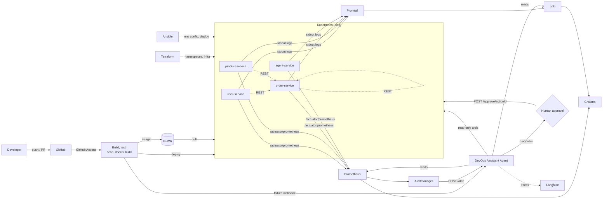

# Agentic AI-Driven DevSecOps Pipeline

End-to-end local DevSecOps platform for a Java (Spring Boot) microservices application, with an **agentic AI assistant** that investigates CI/CD failures, monitoring alerts, and security scan findings, then recommends a fix. Anything state-changing (rollback, restart, scale) requires **human approval**.

> University project. Runs fully on a laptop using free tools only. No paid cloud.

---

## Status

<!-- Badges are added in Phase 2 (CI), Phase 7 (security), later phases as they land. -->
[](https://github.com/OWNER/REPO/actions/workflows/ci.yml)
[](https://github.com/OWNER/REPO/actions/workflows/security.yml)

| Phase | Scope | Status |
|------:|-------|--------|
| 0 | Repo skeleton, README, prerequisites | done |
| 1 | Microservices app + Git workflow | pending |
| 2 | CI pipeline (build matrix, tests, caching, artifacts) | pending |
| 3 | Dockerfiles (multi-stage, non-root), docker-compose, GHCR push | pending |
| 4 | Kubernetes manifests on kind + CD and rollback | pending |
| 5 | Terraform (namespaces/infra) + Ansible (env config) | pending |
| 6 | Monitoring and logging (Prometheus, Grafana, Loki, Promtail, Alertmanager) | pending |
| 7 | DevSecOps (Trivy, Dependency-Check/SonarQube, gitleaks, RBAC, NetworkPolicies) | pending |
| 8 | Agent v1 (CI log analysis, `/analyze-ci`, PR comment) | pending |
| 9 | Agent v2 (Prometheus/Loki/kubectl/Trivy tools, `/alert`, approval gate, audit log) | pending |
| 10 | Evals, Langfuse tracing, Grafana agent panel, demo scripts, report | pending |

---

## Problem

Manual build, deploy, and monitoring is slow and error-prone. When a pipeline fails, a vulnerability is flagged, or a service misbehaves in production, developers burn time reading long logs and switching between CI, monitoring, and security tools. Fixes are delayed, downtime grows, and vulnerabilities slip through.

## Solution

Code pushed to GitHub is built, tested, scanned, containerized, and deployed to Kubernetes. Infrastructure is defined as code. Metrics and logs are collected and visualized. An AI agent is triggered by failures/alerts, investigates with tools, and returns a structured diagnosis plus a recommended action — with human approval for anything risky.

---

## Architecture



Full diagram and component notes: `docs/architecture.md` (Phase 1+).

---

## Tech stack

| Layer | Tools |
|-------|-------|
| Application | Java 17, Spring Boot 3, Maven, Spring Data JPA, H2, JUnit 5, Actuator + Micrometer (Prometheus) |
| VCS / CI/CD | Git, GitHub, GitHub Actions |
| Containers | Docker (multi-stage), Docker Compose, Kubernetes on kind |
| IaC / config | Terraform, Ansible |
| Observability | Prometheus, Grafana, Loki, Promtail, Alertmanager |
| Security | Trivy, OWASP Dependency-Check (or SonarQube), gitleaks, GitHub Secrets, K8s RBAC, NetworkPolicies, non-root containers |
| Agent | Java 17 + Spring Boot (Spring AI / LangChain4j), Ollama local LLM, Langfuse tracing |

---

## Repository structure

```
devsecops-agentic-platform/
├── .github/
│   ├── PULL_REQUEST_TEMPLATE.md
│   └── workflows/            # ci.yml, cd.yml, security.yml (Phase 2+)
├── ansible/
│   ├── inventory/
│   └── playbooks/
├── docs/                     # prerequisites, architecture, report outline, demo scripts
├── evals/                    # failure scenarios, expected root causes, runner script (Phase 10)
├── k8s/
│   ├── base/                 # per-service Deployment/Service/ConfigMap/Secret/HPA/Ingress
│   ├── monitoring/
│   ├── network-policies/
│   └── rbac/
├── monitoring/
│   ├── alertmanager/
│   ├── grafana/dashboards/
│   ├── loki/
│   ├── prometheus/rules/
│   └── promtail/
├── services/
│   ├── agent-service/        # DevOps Assistant Agent (Phase 8+)
│   ├── order-service/        # calls user-service + product-service
│   ├── product-service/
│   └── user-service/
├── terraform/                # namespaces + infra (Phase 5)
├── .gitattributes
├── .gitignore
├── docker-compose.yml        # Phase 3
├── PROJECT_SPEC.md
└── README.md
```

---

## Getting started

1. Install the toolchain — see the [prerequisites checklist](docs/prerequisites.md).
2. Clone the repo **inside WSL2** (recommended, see the checklist notes):
   ```bash
   git clone https://github.com/<you>/devsecops-agentic-platform.git ~/devsecops-agentic-platform
   cd ~/devsecops-agentic-platform
   ```
3. Run the verification commands at the end of [docs/prerequisites.md](docs/prerequisites.md) — all must pass before Phase 1.

Per-phase run instructions are added to this README as each phase lands.

---

## Git workflow

| Branch | Purpose |
|--------|---------|
| `main` | Always deployable. Protected: PR required, CI must pass. |
| `dev` | Integration branch. Feature branches merge here first. |
| `feature/<short-name>` | One unit of work, branched from `dev`. |
| `fix/<short-name>` | Bug fixes. |
| `chore/<short-name>` | Config, CI, docs, repo maintenance. |

Commit messages follow Conventional Commits: `feat:`, `fix:`, `ci:`, `infra:`, `docs:`, `test:`, `chore:`.

Typical flow:

```bash
git switch dev && git pull
git switch -c feature/user-service-crud
# ... work ...
git add -A && git commit -m "feat(user-service): add CRUD REST API"
git push -u origin feature/user-service-crud
# open PR -> dev, fill in PULL_REQUEST_TEMPLATE.md
```

Every PR must state how it was verified and confirm no secrets were committed.

---

## Course outcome mapping

| CO | Outcome | Where it is satisfied |
|----|---------|-----------------------|
| CO1 | DevOps principles (Git workflow, automation, feedback loops) | Phases 1-2: branch strategy, PR template, CI feedback, badges |
| CO2 | CI/CD pipelines | Phases 2, 4: `ci.yml`, `cd.yml`, artifacts, rollback |
| CO3 | Containerization and orchestration | Phases 3-4: multi-stage Dockerfiles, Compose, kind, HPA, Ingress |
| CO4 | Automated infra and config management | Phase 5: Terraform namespaces/infra, Ansible playbooks |
| CO5 | Monitoring and logging | Phase 6: Prometheus, Grafana, Loki, Promtail, Alertmanager |
| CO6 | Security in DevOps | Phase 7: Trivy, Dependency-Check, gitleaks, secrets, RBAC, NetworkPolicies |

---

## Demo scenarios

1. **Broken unit test** — agent explains the failure and suggests the fix.
2. **Vulnerable dependency** — pipeline fails, agent summarizes Trivy findings with upgrade advice.
3. **Pod crash / CPU spike** — Alertmanager triggers the agent; it reads metrics + logs and recommends restart or scale-up.
4. **Rollback** — agent proposes a rollback, human approves, rollback executes.

---

## Agent guardrails

- Read-only by default; every state-changing action needs `POST /approve/{actionId}`.
- Max steps per run and max token budget per run.
- Dedicated Kubernetes ServiceAccount with least-privilege RBAC.
- Append-only audit log of every tool call and decision.
- Secrets only from environment variables / Kubernetes Secrets — never in code or prompts.
- Logs truncated and sanitized before being sent to the LLM.

---

## Documentation

| Document | Contents |
|----------|----------|
| [PROJECT_SPEC.md](PROJECT_SPEC.md) | Full project specification, phases, evaluation plan |
| [docs/prerequisites.md](docs/prerequisites.md) | Tools, versions, install and verification commands |
| `docs/architecture.md` | Mermaid architecture diagram (Phase 1+) |
| `docs/report-outline.md` | Report structure (Phase 10) |
| `docs/demo-scripts.md` | Step-by-step demo runbook (Phase 10) |
