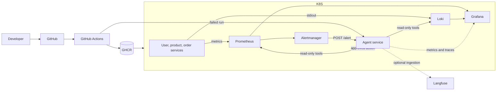

# Architecture

The platform is a local, laptop-sized DevSecOps system. GitHub Actions builds and scans four Spring Boot services, publishes images to GHCR, and deploys them to kind. Terraform owns namespaces and add-ons; Ansible owns environment configuration and workload application.

## Agent flow

`/analyze-ci` fetches a workflow run, limits failed jobs, downloads and sanitizes logs, produces a diagnosis, and optionally posts a pull-request comment. `/alert` normalizes Alertmanager notifications, investigates with bounded Prometheus/Loki/kubectl reads, and proposes an action. `/analyze-security` reads a bounded Trivy report. `/approve/{actionId}` is the only route that can authorize a state-changing proposal.

The agent records Micrometer metrics for request latency, diagnostics, tool calls, low-confidence answers, and estimated cost. Tracing is configurable: `off`, structured `log` output shipped to Loki, or asynchronous Langfuse ingestion. Trace payloads contain metadata, not raw logs or credentials.

## Trust boundaries

- GitHub logs, Alertmanager payloads, and scan reports are untrusted input.
- Log and report content is sanitized, truncated, and checked for prompt-injection-shaped text before reaching a diagnosis engine.
- The agent token and approval token come from Kubernetes Secrets or environment variables.
- The agent ServiceAccount does not mount a token in Phase 8. Phase 9 adds only the read permissions needed for Kubernetes inspection.
- State-changing actions require an approval token and an unexpired pending action.

## Data ownership

Terraform creates namespaces and Helm-managed add-ons. Ansible applies ConfigMaps, Secrets, application manifests, and monitoring manifests. GitHub Actions validates and deploys immutable image tags. Grafana dashboards and Prometheus rules remain versioned ConfigMaps.
